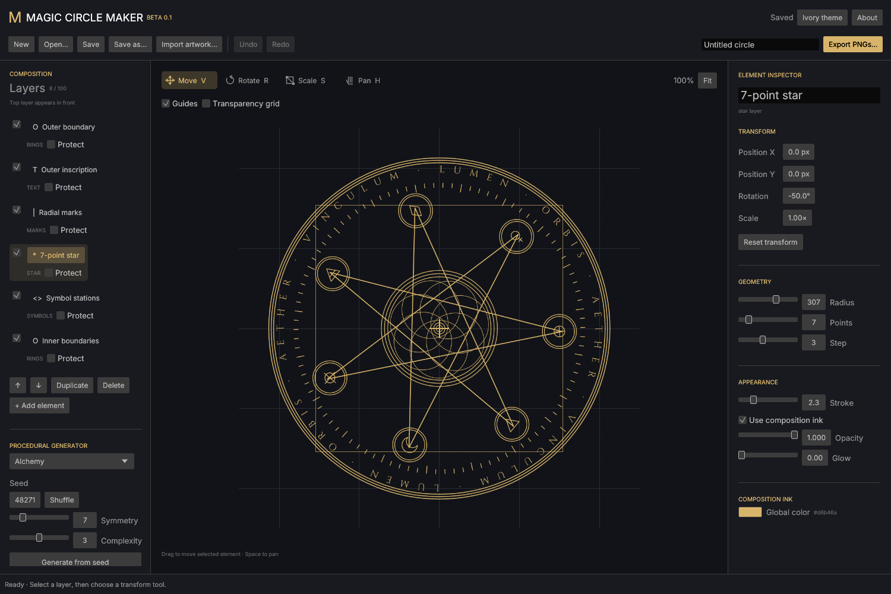
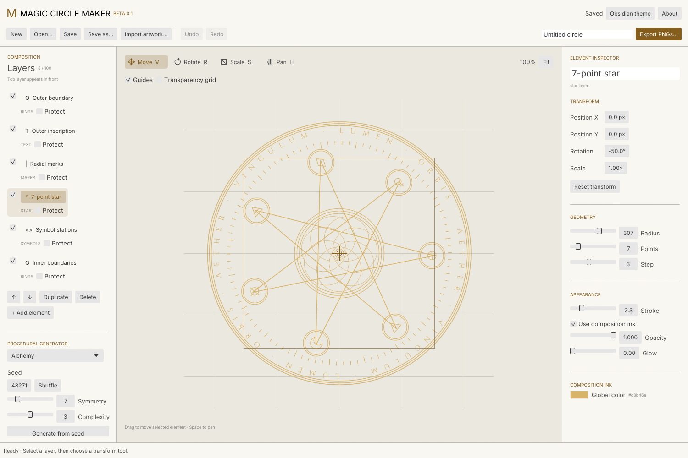

# Magic Circle Maker

A native Rust workbench for generating and editing magic circles, alchemical transmutation designs, geometric seals, and imaginary spells. Start with a repeatable seed, then shape every element by hand.

**[Download the Windows beta](https://github.com/katfacey/magic-circle-maker/releases/tag/v0.1.0-beta.2)** · [Report a bug](https://github.com/katfacey/magic-circle-maker/issues)



## Download and run

1. Open the [beta release](https://github.com/katfacey/magic-circle-maker/releases/tag/v0.1.0-beta.2).
2. Download **MagicCircleMaker-0.1.0-beta.2-windows-x64.zip** and extract it.
3. Run **MagicCircleMaker.exe**. No Rust installation or separate font installation is needed.

The release also includes a standalone EXE and SHA-256 checksums. The ZIP is the recommended download because it keeps the license notices with the application. This is an unsigned beta for 64-bit Windows 10/11 with a graphics driver supporting OpenGL 3.3. It has been built and smoke-tested on Windows; other operating systems do not have release binaries yet.

## What it does

- Generate from **Alchemy**, **Sacred geometry**, and **Astral sigil** recipes. Set the seed, symmetry, and complexity; use **Shuffle** for a fresh seed. The same settings reproduce the same generated geometry.
- Edit rings, star polygons, radial marks, rosettes, symbol stations, and circular inscriptions as individual layers.
- Select a layer, click the **Move**, **Rotate**, or **Scale** symbol above the canvas, then drag. Numeric transform controls provide precise placement. Hold **Shift** while rotating to snap to 15°.
- Change layer order, duplicate, delete, hide, or protect elements. **Protect** preserves an element during regeneration; it still allows manual editing. Imported artwork is also preserved.
- Import **PNG, SVG, JPEG, or WebP** artwork using **Import artwork…** or by dropping files onto the window. Imported artwork becomes a movable, rotatable, scalable layer. Transparency is preserved; SVG is rasterized on import.
- Use bundled, installed system, or custom **TTF/OTF/TTC** fonts. Load an uninstalled font directly from its file in the text inspector.
- Undo and redo edits. Save portable **`.mcm`** projects with imported images and custom font files embedded. A periodic recovery copy can restore an interrupted session.
- Switch between **Obsidian** (default) and **Ivory**. Interface themes do not alter your artwork's ink color.

## Transparent PNG exports

Click **Export PNGs…**, choose **1024**, **2048**, or **4096** square pixels, then select:

| Export | Result |
| --- | --- |
| Each visible layer | A ZIP containing a transparent PNG for every visible layer, plus `manifest.json` |
| Composite | One transparent PNG containing the visible composition |
| Selected layer | One transparent PNG, including a selected layer whose visibility is turned off |

All PNGs in a layer ZIP use the same canvas bounds, dimensions, and origin. They align when imported as layers into GIMP or another image editor. The manifest lists layers from **top to bottom**; lower numbered files go above higher numbered files. Opacity and glow are already baked into each PNG. Hidden layers are omitted from the layer ZIP.

## Controls

| Control | Action |
| --- | --- |
| `V` / `R` / `S` / `H` | Move / Rotate / Scale / Pan tool |
| Drag on canvas | Apply the selected tool to the selected layer |
| `Shift` + rotate drag | Snap rotation to 15° increments |
| `Space` + drag, or middle-button drag | Pan |
| Mouse wheel over canvas | Zoom |
| Fit | Recenter and fit the full composition |
| Double-click canvas | Select the smallest visible element whose bounds contain the pointer |
| `Ctrl+S` / `Ctrl+Shift+S` | Save / Save as |
| `Ctrl+O` | Open a project |
| `Ctrl+Z` / `Ctrl+Shift+Z` | Undo / Redo |
| `Delete` | Delete the selected layer, when a text field is not active |

## Fonts and licensing

**Cinzel**, **IM FELL English**, and **Inter** ship inside the EXE. The exact bundled editions use the **SIL Open Font License 1.1**, allowing personal and commercial use, embedding, and redistribution subject to its terms. They require no paid license. Retain the notices when redistributing the fonts or application. See [font sources and hashes](assets/fonts/SOURCES.md) and the adjacent OFL notices. The personal-use-only Cinzel package from DaFont is **not** included.

System fonts are referenced by family name and must exist on the machine reopening a project. Custom fonts loaded from a file are embedded in the project. You are responsible for permission to embed or redistribute your own fonts and artwork. Artwork exported using the bundled OFL fonts does not inherit the font license.

Application code is [MIT licensed](LICENSE). Dependency and font notices are collected in [THIRD_PARTY_NOTICES.md](THIRD_PARTY_NOTICES.md) and [`docs/licenses`](docs/licenses).

## Beta limits

This release supports up to 100 layers and 30 custom font files. Image imports are limited to 8 MB per source file and normalized to at most 2048 pixels on the longest side. Font files are limited to 12 MB each. Projects have aggregate embedded-asset limits and an 80 MB input limit. Large projects and 4096-pixel exports take longer to render.

SVG assets become raster images; vector/SVG export, animation, nonuniform scaling, multi-selection, and a plugin system are not implemented. Text follows a circle one Unicode character at a time; complex-script shaping and combining-mark placement can be imperfect. Missing fonts can change a preview, so exports report unavailable font families instead of silently substituting them. Existing version-1 web beta project JSON can be opened; some font-family names may need reselecting.

The app works offline. It has no account login, telemetry, or built-in AI service. Its procedural generator creates geometric arrangements from parameters.



## Build from source

Install stable Rust and the Microsoft Visual C++ build tools with a Windows SDK. From a Developer PowerShell terminal:

```powershell
cargo test --locked
cargo build --release --locked
```

The executable is `target/release/magic-circle-maker.exe`. The Windows build uses the static C runtime. `scripts/build.ps1 -Test` runs the tests and release build together. `scripts/package.ps1` creates the distribution ZIP, standalone EXE, and checksums after a successful build.

```powershell
# Render/export/project integration checks, without opening the editor:
target/release/magic-circle-maker.exe --self-test qa

# Capture an actual native-window screenshot and close automatically:
target/release/magic-circle-maker.exe --smoke-test docs/obsidian.png
target/release/magic-circle-maker.exe --light --smoke-test docs/ivory.png
```

The implementation uses egui/eframe for the native UI and resvg/tiny-skia for preview and export rendering. The generator, document validation, transforms, and renderer are separated into Rust modules. Font files and imported images travel with the project; no hosted web page is needed to run the desktop application.

## Feedback

Please [open an issue](https://github.com/katfacey/magic-circle-maker/issues) with what you expected, what happened, your Windows version, and a small reproduction project when possible. Review embedded fonts and artwork before sharing a project publicly.

## AI-assistance disclosure

This application, its documentation, and its initial release were created with assistance from **OpenAI’s ChatGPT/Codex**. AI-assisted work can contain errors. This beta is provided as-is, without warranty; please report bugs and keep backups of important projects.
